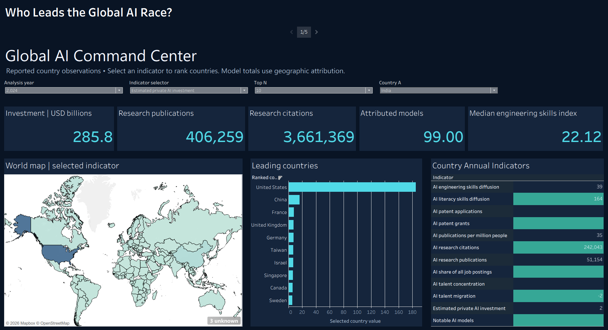

# global-ai-race
Comparing AI investment, research, model development, and workforce indicators across countries.

# Who Leads the Global AI Race?
[View the interactive Tableau story: Who Leads the Global AI Race?](https://public.tableau.com/shared/WKC5DSNRF?:display_count=n&:origin=viz_share_link)

I built this Tableau project to explore a question: does the country leading
in AI investment also lead in research, model development, and workforce skills?

## Explore the story

| Story point | What you can explore |
|---|---|
| Global AI Command Center | Rank countries by indicator and year |
| AI Leadership Comparison Lab | Compare two countries on the same metric |
| Evolution of AI | Follow investment, research, models, and skills over time |
| AI Explorer | Compare investment with publications and research intensity |
| Data Coverage | Select a reported or missing count to inspect individual observations |

## What I found

The United States had more fractionally attributed notable AI models than
Canada in 2022. Canada had a higher engineering skills index in 2025.
The answer to “who leads?” depends on the measure and reporting period.

## How I checked the data

- Reconciled 11,926 observations across 14 indicators with the cleaned sources.
- Used fractional attribution for models associated with multiple countries.
- Preserved 429 missing measurements. The coverage dashboard lets readers
  inspect the country and date behind each missing value.

**Tools:** Tableau Desktop, Excel, Power Query
